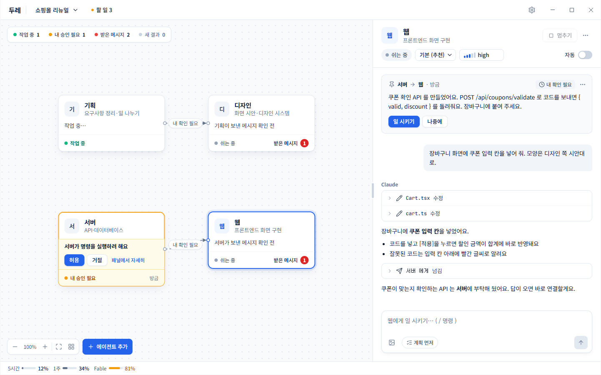

# 두레 (Dure)

**Agents in concert. Human in control.**

> 비공식 · 팀 내부용 · 본인 Claude 구독 필요

여러 Claude 에이전트를 한 창에 띄워 두고, 에이전트끼리 일을 넘기게 하는 Windows 데스크톱 앱이에요. 사람은 관계도로 흐름을 보면서 승인만 하면 돼요.


<picture>
  <source media="(prefers-color-scheme: dark)" srcset=".github/readme/screen-dark.png">
  
</picture>

## 왜 만들었나

폴더마다 Claude 를 하나씩 돌리며 일하면, 한 에이전트가 "이건 저쪽 담당"인 일을 자주 발견해요. 지금까지는 사람이 그 내용을 복사해 다른 창에 붙여 넣었어요. 두레에서는 에이전트가 직접 일을 넘기고, 사람은 받은 쪽 카드에서 **[일 시키기]** 만 누르면 돼요.

## 할 수 있는 것

- **방과 관계도** — 프로젝트마다 방 하나. 에이전트는 폴더 + 이름 + 역할 한 줄이에요. 누가 누구에게 일을 넘겼는지 선으로 보여요.
- **에이전트끼리 일 넘기기** — 받은 메시지는 [일 시키기] · [나중에] 로 사람이 시작해요. 에이전트의 '자동' 을 켜면 바로 시작하고, 자동으로 이어지는 전달은 3번에서 멈춰요.
- **채팅 패널** — 마크다운 답, 하는 일 한 줄 요약, 고친 파일의 바뀐 줄, 서브에이전트 탭, 그림 붙여 넣기·크게 보기, 슬래시 명령.
- **승인과 통제**
  - 권한 카드 — 허용 · 거절 · "앞으로 이 에이전트의 ○○ 은 묻지 않기". 묻지 않기로 한 일은 '항상 허용한 일' 목록에서 되돌릴 수 있어요.
  - Claude 가 되묻는 질문은 카드로 답해요.
  - **계획 먼저** — 계획을 먼저 받아 보고 [이대로 진행] 이나 [고쳐 달라고 하기] 로 답해요.
  - **멈추기** — 입력창에서 Esc. 멈추는 사이 쌓인 입력은 붙잡아 두고 보낼지 버릴지 골라요.
- **맡기는 정도** — 끔 · 자동 · 묻지 않음. 묻지 않음은 설정에서 허용했을 때만 고를 수 있어요.
- **휴대폰으로 쓰기** — 밖에서 휴대폰으로 에이전트 일을 보고 승인해요. 내 Tailscale 기기에서만 열려요. 안드로이드 앱도 있어요.
- **흘끗 보기** — 내가 할 일 모아 보기, 작업 표시줄 배지·깜박임, Windows 알림.
- **모델·effort·사용량** — 에이전트마다 모델과 effort 를 고르고, 아래 띠에서 플랜 사용량을, 입력창에서 대화 길이(context)를 봐요.
- **새 에이전트 만들기** — 에이전트가 새 에이전트를 제안하면 사람이 승인해야 생겨요.
- 라이트 · 다크 · Windows 따라감.

## 설치하기

1. [GitHub Releases](https://github.com/choiy4432/dure/releases) 에서 가장 새 `Dure-Setup-<버전>.exe` 를 받아 실행해요.
2. 앱에 코드 서명이 없어서 Windows 가 "Windows의 PC 보호" 경고를 띄워요. **추가 정보** → **실행** 을 차례로 누르면 설치돼요.
3. 처음 켜면 준비 화면(claude 설치·로그인)과 안내 투어가 차례로 이끌어요.

<!-- 경고 화면 그림 둘(추가 정보 / 실행)은 resources/readme/ 에 찍어 두면 여기에 넣어요. -->

**업데이트** — 두레를 켤 때 새 버전이 있는지 한 번 확인해요. 있으면 오른쪽 아래 알림에서 **[업데이트]** 로 받고, 다 받으면 **[지금 다시 켜기]**(또는 끌 때) 바뀌어요. 손으로 확인하려면 **설정 → 두레 → [업데이트 확인]**. 다시 켜면 일하던 에이전트는 멈추고, 다시 켜진 뒤 말을 걸면 이어서 해요.

**지우기** — Windows 설정 → 앱 → 설치된 앱에서 **Dure** 를 제거해요. 방·에이전트·대화가 든 `%APPDATA%\Dure` 폴더는 지우지 않고 남겨요(다시 깔면 그대로 보여요). 깨끗이 지우려면 제거한 뒤 그 폴더를 직접 지워요.

## 휴대폰으로 쓰기

밖에서 휴대폰으로 에이전트 일을 보고 승인할 수 있어요. 두레의 휴대폰 화면은 **내 Tailscale 기기에서만** 열려요 — 공개 인터넷에는 열지 않아요.

**준비** — PC 와 휴대폰 둘 다에 Tailscale 을 깔고 같은 계정으로 로그인해요. 처음 한 번은 Tailscale 에서 HTTPS(Serve)를 켜야 해요. 두레가 설정 창에서 어디서 켜는지 안내해요.

**켜기**

1. 두레 위 띠의 톱니(설정) → **휴대폰** 탭에서 **휴대폰으로 쓰기** 를 켜요. 휴대폰 주소가 열릴 때까지 10~30초쯤 걸려요.
2. **[휴대폰 짝 맺기]** 를 누르면 QR 이 떠요. 휴대폰 카메라로 찍어 열고, 휴대폰의 "이 휴대폰을 두레와 짝 맺을까요?" 화면에서 **[짝 맺기]** 를 눌러요. 홈 화면에 추가한 앱(아이폰)처럼 QR 로 열 수 없을 때는 QR 옆 숫자 6자리를 휴대폰에 넣어요.

**알림** — 휴대폰 탭의 **휴대폰 알림** 에서 **승인·질문이 오면** · **답이 오면** 을 골라요. PC 를 쓰는 중이면 휴대폰으로 보내지 않고, 자리를 비우면 그때 보내요. 30일 동안 안 쓴 휴대폰은 짝이 풀려요. 다시 쓰려면 짝을 새로 맺어요.

**안드로이드 앱 (권장)** — 앱으로 쓰면 알림에 주소가 안 붙고, 알림이 화면 위 팝업으로 와요. 크롬이 깔려 있어야 하고, 삼성 인터넷 같은 다른 브라우저로는 안 돼요.

1. 휴대폰 탭의 **안드로이드 앱** 에서 **[앱 받기]** 를 눌러 QR 을 휴대폰 카메라로 찍고 앱을 받아요.
2. 설치할 때 '출처를 알 수 없는 앱'을 허용해요. Play 프로텍트 경고가 뜨면 **[그래도 설치]** 를 눌러요.
3. PC 두레의 휴대폰 탭 QR 로 크롬에서 두레 화면을 열고 **[두레 앱으로 열기]** 를 눌러요.
4. 앱 안에서 "알림을 켜야 휴대폰으로 알림이 와요" 띠의 **[켜기]** 를 눌러 알림을 허용해요.

**아이폰** — 앱은 없어요. 사파리로 주소를 열고 '홈 화면에 추가'한 뒤, 홈 화면의 두레를 열어 짝을 맺고 알림을 켜요.

**안 될 때**

- **PC 에 닿지 않아요** 가 뜨면 — PC 가 켜져 있는지, 두레가 떠 있는지, PC 와 휴대폰 둘 다 Tailscale 이 켜져 있는지 봐요.
- 노트북은 덮개를 닫으면 잠들어요. Windows 전원 설정의 '덮개를 닫을 때'를 '아무 것도 안 함'으로 바꿔요(두레 휴대폰 탭의 **PC 전원** 에도 적혀 있어요).
- 안드로이드 앱을 지웠다 다시 깔았는데 알림에 주소가 붙으면 크롬을 한 번 완전히 껐다 켜요.
- Tailscale 에서 PC 이름을 바꾸면 주소가 달라져요. 바꾸기 전에 두레의 **휴대폰으로 쓰기** 를 끄고, 바꾼 뒤 다시 켜요. 앱에는 새 주소의 QR 로 크롬에서 **[두레 앱으로 열기]** 를 다시 눌러요.

## 필요한 것

- Windows 10/11 (64비트)
- Claude 구독 — 두레는 이 PC 의 `claude` 를 내 Claude 계정으로 움직여요. `claude` 가 없거나 로그인이 안 돼 있으면 처음 켤 때 준비 화면에서 Anthropic 공식 설치 스크립트로 설치하고(관리자 권한 없이) 로그인까지 이어 줘요. 이미 깔려 있으면 그것을 써요.
- 두레를 켤 때 `claude` 도 최신 버전으로 바꿔요(설정 → 두레 → 켤 때 claude 최신으로 에서 끌 수 있어요).
- Tailscale — 휴대폰으로 쓸 때만 필요해요(PC 와 휴대폰 둘 다, 같은 계정).
- Node.js 20 이상, Git — 소스에서 직접 실행할 때만 필요해요.

## 소스에서 실행하기

```
git clone https://github.com/choiy4432/dure.git
cd dure
npm install
npm run build
npm start
```

처음 쓸 때:

1. 위 띠에서 방을 만들어요.
2. **에이전트 추가** → 폴더 · 이름 · 역할.
3. 카드를 눌러 오른쪽 패널에서 일을 시켜요.
4. 에이전트가 다른 에이전트에게 넘긴 일은 받는 쪽 카드에 '받은 메시지' 로 떠요. [일 시키기] 를 누르면 시작해요.

## 어떻게 동작하나

- 에이전트마다 그 폴더에서 PC 의 `claude` 를 헤드리스(stream-json)로 띄워요. 내 Claude 설정 · CLAUDE.md · 훅 · MCP 가 그대로 적용돼요.
- 두레가 로컬 MCP 서버로 `send_message` · `list_agents` · `create_agent` 도구를 줘요. Claude 는 이 도구로 다른 에이전트에게 일을 넘겨요.
- 권한 요청과 질문은 두레로 와서 카드로 떠요.
- 휴대폰으로 쓰기를 켜면 두레가 PC 의 Tailscale 로 주소 하나(예: `https://my-pc.tail0000.ts.net`)를 내 tailnet 안에만 열어요. 짝 맺은 휴대폰만 들어와요.
- 방 · 에이전트 · 대화 기록 · 메시지 · 설정은 이 PC 의 `%APPDATA%\Dure` 에만 저장해요. 두레의 서버와 계정은 없어요.

## 지키는 선

- Claude Code 를 앱에 넣어 배포하지 않아요. PC 에 설치된 `claude` 를 불러요.
- 자격 증명 파일을 읽거나 옮기지 않고, API 키를 쓰지 않아요.

## 개발

| 명령 | 하는 일 |
|---|---|
| `npm run dev` | 고치면 바로 반영되는 개발 실행 |
| `npm test` | 단위·화면 시험(vitest) |
| `npm run typecheck` | 타입 검사 |
| `npm run e2e` | 실제 앱 시험(Playwright, 가짜 claude) |
| `npm run smoke` | 진짜 claude 로 엔진 점검 — 사용량이 들어요(haiku) |

- `src/engine` — UI 를 모르는 엔진(claude 프로세스·메시지 전달·권한·기록)
- `src/main` · `src/preload` — Electron 창과 IPC
- `src/renderer` — React 화면(관계도는 React Flow)
- `src/shared` — main ↔ 화면 계약
- `test/fakeClaude.mjs` — 시험용 가짜 claude

## 상태

개발 중이에요. 맥과 리눅스는 지원하지 않아요.

## 릴리스 올리기

1. 안드로이드 앱을 굽는다: `npm run android`. 환경 변수 두 개가 필요해요 — `DURE_ANDROID_TOOLS`(JDK·Android SDK·Gradle 이 든 폴더)와 `DURE_ANDROID_KEYSTORE_PASS`(서명 열쇠 비밀번호). 진짜 서명 열쇠는 `%USERPROFILE%\.dure-release\android-release.jks` 에 둬요(다른 곳이면 `DURE_ANDROID_KEYSTORE`).
   - 앱 껍데기(`android/`)를 그대로 두었고 전에 진짜로 구운 앱이 있으면 다시 안 구워도 돼요. 릴리스가 앱 파일·판·패키지·껍데기 소스를 맞춰 보고, 안 맞으면(시험용 `--test` 로 구운 것 포함) 올리기 전에 멈춰요.
2. `npm run release -- --notes <노트 파일>` (먼저 `--dry-run` 으로 할 일만 확인). 노트는 맨 앞이 `- ` 목록이에요. 올리기 전에 typecheck 와 시험을 먼저 돌리고, 하나라도 실패하면 멈춰요.
3. 릴리스는 **초안(draft)** 으로 올라가요. GitHub 에서 초안을 확인하고 [Publish release] 를 누르면 그때 자동 업데이트가 나가요.

> ⚠️ **서명 열쇠 파일(`android-release.jks`)과 그 비밀번호를 꼭 따로 백업해 두세요**(USB · 비밀번호 관리자 등).
> 잃으면 안드로이드 앱을 **다시는 업데이트할 수 없어요** — 같은 앱을 다른 열쇠로는 덮어 깔 수 없어서, 쓰는 사람 모두 앱을 지우고 다시 깔아야 해요.

## 라이선스

MIT 라이선스예요 — [LICENSE](LICENSE) 를 봐 주세요. 설치 파일에 든 글꼴(Noto Sans KR · JetBrains Mono)은 SIL OFL 1.1 이고, 고지는 [THIRD_PARTY_NOTICES.md](THIRD_PARTY_NOTICES.md) 에 있어요. 설치 파일에도 `LICENSE` 와 `THIRD_PARTY_NOTICES.md` 가 함께 들어 있어요(설치 폴더의 `resources`).
