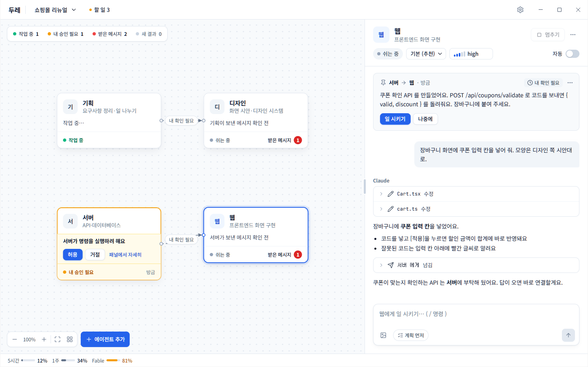

# 두레 (Dure)

**Agents in concert. Human in control.**

여러 Claude 에이전트를 한 창에 띄워 두고, 에이전트끼리 일을 넘기게 하는 Windows 데스크톱 앱이에요. 사람은 관계도로 흐름을 보면서 승인만 하면 돼요.

> 비공식 · 팀 내부용 · Anthropic 과 무관해요. 각자 자기 Claude 구독과 PC 에 설치한 Claude Code 를 써요.

<picture>
  <source media="(prefers-color-scheme: dark)" srcset=".github/readme/screen-dark.png">
  
</picture>

## 왜 만들었나

폴더마다 Claude 를 하나씩 돌리며 일하면, 한 에이전트가 "이건 저쪽 담당"인 일을 자주 발견해요. 지금까지는 사람이 그 내용을 복사해 다른 창에 붙여 넣었어요. 두레에서는 에이전트가 직접 일을 넘기고, 사람은 받은 쪽 카드에서 **[일 시키기]** 만 누르면 돼요.

## 할 수 있는 것

- **방과 관계도** — 프로젝트마다 방 하나. 에이전트는 폴더 + 이름 + 역할 한 줄이에요. 누가 누구에게 일을 넘겼는지 선으로 보여요.
- **에이전트끼리 일 넘기기** — 받은 메시지는 [일 시키기] · [나중에] 로 사람이 시작해요. 에이전트의 '자동' 을 켜면 바로 시작하고, 자동으로 이어지는 전달은 3번에서 멈춰요.
- **채팅 패널** — 마크다운 답, 하는 일 한 줄 요약, 고친 파일의 바뀐 줄, 서브에이전트 탭, 그림 붙여 넣기·크게 보기, 슬래시 명령.
- **승인과 통제**
  - 권한 카드 — 허용 · 거절 · "앞으로 이 에이전트의 ○○ 은 묻지 않기". 묻지 않기로 한 일은 '항상 허용한 일' 목록에서 되돌릴 수 있어요.
  - Claude 가 되묻는 질문은 카드로 답해요.
  - **계획 먼저** — 계획을 먼저 받아 보고 [이대로 진행] 이나 [고쳐 달라고 하기] 로 답해요.
  - **멈추기** — 입력창에서 Esc. 멈추는 사이 쌓인 입력은 붙잡아 두고 보낼지 버릴지 골라요.
- **맡기는 정도** — 끔 · 자동 · 묻지 않음. 묻지 않음은 설정에서 허용했을 때만 고를 수 있어요.
- **흘끗 보기** — 내가 할 일 모아 보기, 작업 표시줄 배지·깜박임, Windows 알림.
- **모델·effort·사용량** — 에이전트마다 모델과 effort 를 고르고, 아래 띠에서 플랜 사용량을, 입력창에서 대화 길이(context)를 봐요.
- **새 에이전트 만들기** — 에이전트가 새 에이전트를 제안하면 사람이 승인해야 생겨요.
- 라이트 · 다크 · Windows 따라감.

## 필요한 것

- Windows 10/11 (64비트)
- Claude 구독, 그리고 Claude Code 설치·로그인 — 명령 프롬프트에서 `claude` 가 실행되는 상태. 못 찾으면 두레가 알려 줘요.
- Node.js 20 이상, Git — 아직 설치 파일이 없어서 소스에서 실행해요.

## 실행하기

```
git clone https://github.com/choiy4432/dure.git
cd dure
npm install
npm run build
npm start
```

처음 쓸 때:

1. 위 띠에서 방을 만들어요.
2. **에이전트 추가** → 폴더 · 이름 · 역할.
3. 카드를 눌러 오른쪽 패널에서 일을 시켜요.
4. 에이전트가 다른 에이전트에게 넘긴 일은 받는 쪽 카드에 '받은 메시지' 로 떠요. [일 시키기] 를 누르면 시작해요.

## 어떻게 동작하나

- 에이전트마다 그 폴더에서 PC 의 `claude` 를 헤드리스(stream-json)로 띄워요. 내 Claude 설정 · CLAUDE.md · 훅 · MCP 가 그대로 적용돼요.
- 두레가 로컬 MCP 서버로 `send_message` · `list_agents` · `create_agent` 도구를 줘요. Claude 는 이 도구로 다른 에이전트에게 일을 넘겨요.
- 권한 요청과 질문은 두레로 와서 카드로 떠요.
- 방 · 에이전트 · 대화 기록 · 메시지는 `%APPDATA%\Dure` 에만 저장해요. 서버와 계정은 없어요.

## 지키는 선

- Claude Code 를 앱에 넣어 배포하지 않아요. PC 에 설치된 `claude` 를 불러요.
- 자격 증명 파일을 읽거나 옮기지 않고, API 키를 쓰지 않아요.
- 제품 이름에 "Claude Code" 를 쓰지 않아요.

## 개발

| 명령 | 하는 일 |
|---|---|
| `npm run dev` | 고치면 바로 반영되는 개발 실행 |
| `npm test` | 단위·화면 시험(vitest) |
| `npm run typecheck` | 타입 검사 |
| `npm run e2e` | 실제 앱 시험(Playwright, 가짜 claude) |
| `npm run smoke` | 진짜 claude 로 엔진 점검 — 사용량이 들어요(haiku) |

- `src/engine` — UI 를 모르는 엔진(claude 프로세스·메시지 전달·권한·기록)
- `src/main` · `src/preload` — Electron 창과 IPC
- `src/renderer` — React 화면(관계도는 React Flow)
- `src/shared` — main ↔ 화면 계약
- `test/fakeClaude.mjs` — 시험용 가짜 claude

## 상태

개발 중이에요. 설치 파일, 첫 실행 안내, 자동 업데이트는 아직 없어요. 맥과 리눅스는 지원하지 않아요.

## 라이선스

없어요 — 팀 내부용으로 공개해 둔 레포예요.
